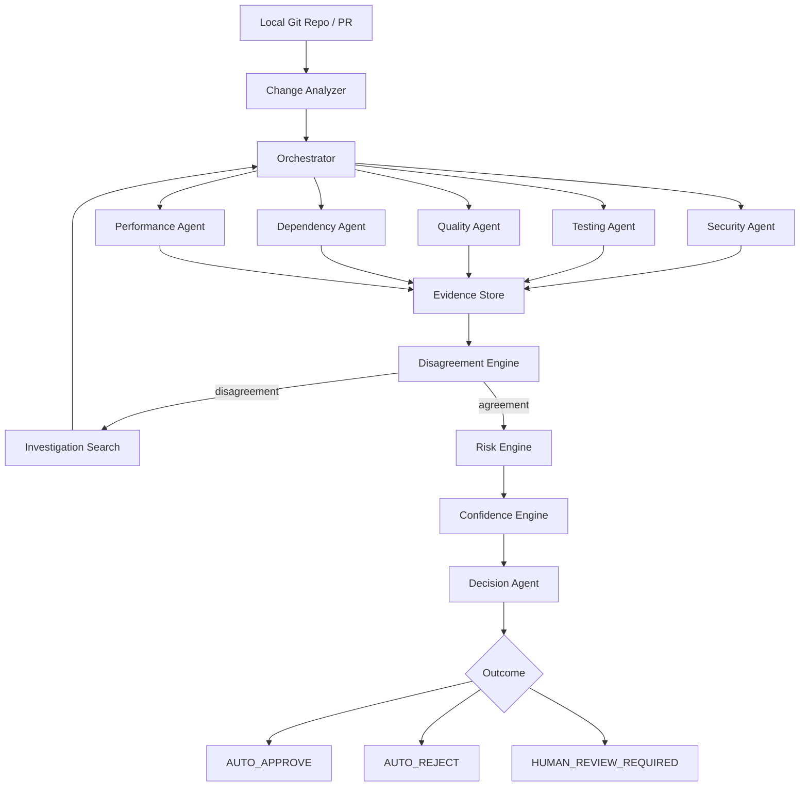
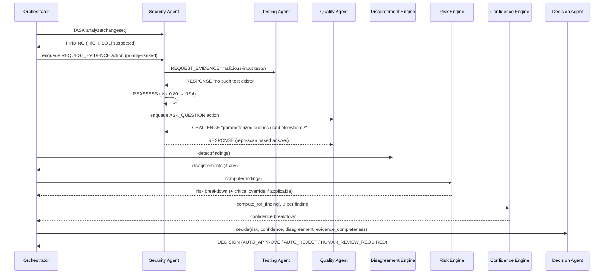

# Architecture — RAMAV

## High-level architecture



This is deliberately NOT "5 tools in parallel → average". The Orchestrator
holds state (`OrchestratorState`) across the whole run, and the
Disagreement Engine / Investigation Search can loop back and cause agents to
re-communicate before Risk/Confidence/Decision ever run.

## Component architecture (code map)

```
backend/app/
├── main.py                    Flask HTTP layer (routes only — no business logic)
├── agents/
│   ├── base_agent.py          Common agent interface + messaging helpers
│   ├── security_agent.py      Semgrep/fallback + repo-convention lookups
│   ├── testing_agent.py       Real pytest/unittest execution + test-tree search
│   ├── quality_agent.py       AST-based checks
│   ├── dependency_agent.py    Manifest diffing
│   ├── performance_agent.py   AST loop/DB-call heuristics (never fabricates a benchmark)
│   ├── repair_agent.py        Narrow, rule-based patch generation
│   ├── decision_agent.py      Deterministic final decision policy
│   └── orchestrator.py        THE coordination layer — state + investigation loop
├── analysis/change_analyzer.py   Builds ChangeSet from a real `git diff`
├── coordination/
│   ├── messages.py            AgentMessage + MessageBus (the protocol)
│   └── disagreement.py        DisagreementEngine
├── evidence/store.py          Finding / Evidence / EvidenceStore (source_type tagging)
├── risk/engine.py             RiskEngine (weighted + critical override)
├── confidence/engine.py       ConfidenceEngine (explainable component breakdown)
├── search/investigation.py    Best-first investigation planner (priority queue)
├── integrations/
│   ├── semgrep_adapter.py     Real Semgrep + deterministic fallback
│   └── git_utils.py           Real `git diff` / `git log`
├── services/
│   ├── repair_service.py      Closed-loop repair + full pipeline re-run
│   └── system_health.py       Tool availability checks
├── database/db.py             SQLite persistence (stdlib sqlite3)
└── config/settings.py         Central, documented policy parameters
```

## Communication protocol

Every agent interaction is an `AgentMessage` (see
`app/coordination/messages.py`) with a `type` from: `TASK`, `FINDING`,
`QUESTION`, `REQUEST_EVIDENCE`, `RESPONSE`, `CHALLENGE`, `DISAGREEMENT`,
`REASSESS`, `ESCALATE`, `DECISION`. All messages are appended to a
`MessageBus` that is returned to the frontend verbatim (see the "Agent
Conversation" dashboard page) and persisted with the analysis run.

## Data flow for one analysis run



## Investigation loop (search strategy)

See `app/search/investigation.py`. State = current findings + evidence +
confidence + open questions + disagreements. Actions = invoke agent /
request evidence / ask question / reassess / rerun / escalate. Cost = a
fixed estimate per action type. Priority:

```
priority(action) = severity(action) * uncertainty(action) * impact(action) / estimated_cost(action)
```

This is a best-first search over a priority queue (`heapq`), capped at a
configurable action budget (`max_actions`, default 12) after which the
system escalates rather than looping forever. See `docs/RUBRIC_MAPPING.md`
for how this maps to the "Algorithmic Modeling & Search Strategy" rubric.

## Risk engine

`overall_risk = Σ(category_risk × normalised_weight)`, where a category's
risk is the **max**, not the average, of its findings (so one severe
finding is never diluted by several minor ones from the same agent). A
critical finding (CRITICAL severity, or a security finding with risk ≥
0.85) forces `critical_override = True`, which the Decision Agent checks
*before* anything else — a critical vulnerability can never be averaged
away.

## Confidence engine

Documented in `app/confidence/engine.py`. Five weighted positive factors
(agent confidence, evidence strength, tool reliability, agreement, evidence
completeness) minus an uncertainty penalty proportional to open questions.
Overall confidence is the **minimum** across all findings that are MEDIUM+
severity ("weakest link"), or the mean across LOW/INFO findings when there
is nothing risky to be the weakest link ("safe PR" case).

## Decision engine

Deterministic. Order of checks: critical override → unresolved disagreement
→ high-risk-with-high-confidence → low-risk-with-high-confidence-and-complete-evidence
→ otherwise HUMAN_REVIEW_REQUIRED. See `app/agents/decision_agent.py` for
the exact thresholds (project policy, not scientifically tuned — see
docs/VIVA_PREPARATION.md).

## GitHub integration

This build supports **local-clone mode** only (`POST /api/analyze/pr` with
a `local_clone_path`) because the build/grading sandbox has no outbound
network access to call the GitHub API. Wiring a live token + webhook is a
documented extension point, not implemented here, to avoid claiming
untested behaviour.

## Local demo architecture

Each of the 5 demo scenarios (`demo-repository/scenarios/*`) is a real
2-commit git repository (baseline commit + "PR" commit), built by
`scripts/setup_demo_repos.py`. The Change Analyzer runs a genuine
`git diff --name-only HEAD~1..HEAD` against them — nothing about "what
changed" is hardcoded.
